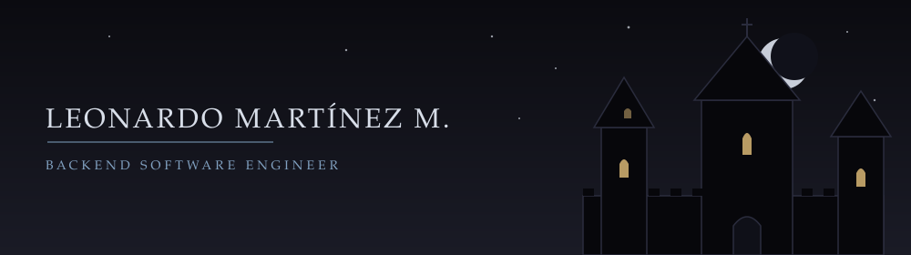

 

 
 

*"Me quedé porque temía lo que sería sin ella."*  
— Fiódor Dostoyevski

 

NestJS &middot; TypeScript &middot; Prisma &middot; AI-Assisted Workflows  
*22 years old &middot; Puebla, México &middot; Romantic at heart*

&mdash;&mdash;&mdash; &nbsp;&dagger;&nbsp; &mdash;&mdash;&mdash;

<h3 align="center">A B O U T &nbsp; M E</h3>

I am a software developer focused primarily on backend engineering with NestJS, TypeScript and Prisma.
My frontend knowledge lets me understand and support the full development cycle.

To optimize my code and my daily work, I integrate AI tools into my workflow:
Antigravity (IDE and CLI), Claude, custom skills and MCP servers.

I like to do things right from the start: standardizing processes and defining good practices
to avoid problems down the road.

&mdash;&mdash;&mdash; &nbsp;&dagger;&nbsp; &mdash;&mdash;&mdash;

<h3 align="center">P R I N C I P L E S</h3>

<b>Clean architecture</b> 
Simple, readable and maintainable designs.

<b>Standardization</b> 
Clear conventions and processes, defined early.

<b>Teamwork</b> 
I value my team, listen to different points of view and make technical decisions together, or by vote when the challenge calls for it.

<b>Openness to feedback</b> 
I learn from those with more experience and help wherever I can to get the project across the finish line.

&mdash;&mdash;&mdash; &nbsp;&dagger;&nbsp; &mdash;&mdash;&mdash;

<h3 align="center">C R A F T</h3>

<b>Backend</b>  &mdash; REST API design, modular architecture with NestJS, data modeling with Prisma and PostgreSQL. 
<b>Documentation</b>  &mdash; APIs documented with Swagger and Scalar. 
<b>AI-assisted development</b>  &mdash; Antigravity, Claude, custom skills and MCP servers integrated into daily work. 
<b>Frontend</b>  &mdash; Next.js, React and Tailwind CSS to support the full cycle.

&mdash;&mdash;&mdash; &nbsp;&dagger;&nbsp; &mdash;&mdash;&mdash;

<h3 align="center">T E C H &nbsp; S T A C K</h3>

  

  

  

  
  
  
  

&mdash;&mdash;&mdash; &nbsp;&dagger;&nbsp; &mdash;&mdash;&mdash;

<h3 align="center">P L A Y L I S T</h3>

  

&mdash;&mdash;&mdash; &nbsp;&dagger;&nbsp; &mdash;&mdash;&mdash;

<h3 align="center">C O N T R I B U T I O N S</h3>

  

